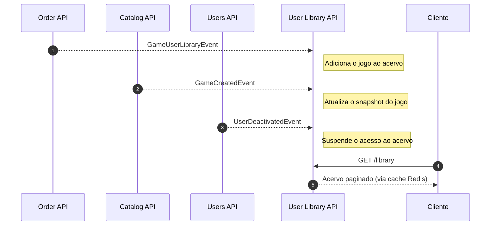

# Fiap Cloud Games (FCG) - User Library API

Este microsserviço é responsável pela **biblioteca de jogos de cada usuário** da plataforma **Fiap Cloud Games (FCG)** — o acervo pessoal que reúne os títulos já adquiridos. Desenvolvido em **.NET 9**, adota **Clean Architecture**, **Domain-Driven Design (DDD)** e separação entre escrita e leitura (**CQRS**).

O serviço é essencialmente **reativo**: a biblioteca nunca é alterada por chamadas HTTP. Toda escrita nasce de eventos publicados por outros microsserviços, e a API expõe apenas a **leitura** do acervo ao usuário autenticado.

---

## 🔄 Fluxo de Eventos e Responsabilidades

A comunicação é assíncrona, via **RabbitMQ** (abstraído pelo **MassTransit**).



### 📥 Eventos Consumidos

| Evento | Origem | O que faz |
| :--- | :--- | :--- |
| `IGameUserLibraryIntegrationEvent` | Order API | **Adiciona o jogo** à biblioteca, após o pagamento aprovado. |
| `IGameCreatedIntegrationEvent` | Catalog API | Cria o *snapshot* local do jogo (nome, descrição, gênero). |
| `IUserDeactivatedIntegrationEvent` | Users API | Desativa a biblioteca, suspendendo o acesso ao acervo. |
| `IUserReactivatedIntegrationEvent` | Users API | Reativa a biblioteca do usuário. |

### 📤 Eventos Publicados

Nenhum. Este serviço é **terminal** no fluxo de eventos: ele consome e persiste, mas não propaga novos eventos de integração ao ecossistema.

### 🗂️ Snapshots Locais (Replicação por Eventos)

A User Library **não consulta a Catalog API** para exibir os dados de um jogo. Ela mantém uma cópia local (`GameSnapshot`) alimentada por eventos. Assim, listar a biblioteca não depende da disponibilidade do catálogo, e a consulta se resolve inteiramente dentro deste serviço.

---

## 🌐 Endpoints da API

| Método | Rota | Descrição |
| :--- | :--- | :--- |
| `GET` | `/api/library` | Lista, de forma paginada, a biblioteca de games do usuário autenticado. |

O endpoint exige autenticação **JWT** e devolve apenas o acervo do usuário identificado no token. Em execução pelo ecossistema completo, o acesso se dá pelo **Kong** em `http://localhost:8000/library` — o gateway valida o token e aplica rate limiting antes de encaminhar a requisição. A documentação **Swagger** fica disponível em `/swagger` quando a API é executada isoladamente.

> [!NOTE]
> Não há endpoints de escrita — nem para adicionar, nem para remover jogos. Um título só entra na biblioteca pelo evento `GameUserLibraryEvent`, publicado pela *Order API* depois que o pagamento foi aprovado. Essa restrição é intencional: impede que o acervo seja alterado sem passar pelo fluxo de compra.

### 🩺 Health Checks

| Rota | Uso |
| :--- | :--- |
| `/health/liveness` | O processo está de pé. |
| `/health/readiness` | Dependências (SQL Server e Redis) estão acessíveis. |

O `docker-compose.yml` do repositório de infraestrutura usa `/health/readiness` para liberar a subida do gateway.

---

## 🛠️ Tecnologias e Bibliotecas

- **.NET 9.0**: Framework principal para o desenvolvimento da API.
- **MongoDB (MongoDB.Driver)**: Banco de dados principal do domínio — armazena `LibraryEntry` e `GameSnapshot`, tanto na escrita quanto na leitura (listagem paginada do acervo). Coleções e índices são criados automaticamente na subida da aplicação, sem migrations.
- **Entity Framework Core 9.0 + SQL Server**: não guarda dados de domínio; é usado exclusivamente pelo **Transactional Outbox/Inbox do MassTransit**, garantindo consistência entre a persistência de cada evento consumido e o registro correspondente no outbox.
- **MediatR (v14)**: Implementação do padrão Mediator para desacoplamento e gerenciamento de comandos internos.
- **MassTransit**: Framework de mensageria que abstrai a comunicação com o **RabbitMQ**, com outbox baseado em EF Core e política de retry por endpoint.
- **Redis (StackExchange)**: Cache distribuído da listagem da biblioteca.
- **Serilog**: Logging estruturado em formato compacto.
- **xUnit & Moq**: Frameworks para construção e execução de testes unitários.

### 📦 Shared Kernels (Pacotes Compartilhados da FCG)
Projetos criados internamente e utilizados para padronizar e compartilhar recursos base:
- **Fcg.Core.Abstractions**: Biblioteca de blocos de construção para Domain-Driven Design (DDD) em projetos .NET.
- **Fcg.Core.SharedContracts**: Contratos de eventos compartilhados para comunicação assíncrona entre os microsserviços da plataforma FCG.
- **Fcg.Core.WebApi**: Configurações compartilhadas de host, autenticação JWT, health checks e Serilog.

---

## 🏗️ Arquitetura da Solução

```
src/
├── Fcg.UserLibrary.Domain         # Entidades de Domínio e Interfaces de Repositório
├── Fcg.UserLibrary.Application    # Casos de Uso (Commands/Queries) e Handlers do MediatR
├── Fcg.UserLibrary.Infrastructure # Acesso a Dados (MongoDB + Outbox EF Core/SQL Server), Consumers e Cache
└── Fcg.UserLibrary.API            # Controllers, Middlewares e Inicialização (Program.cs)
```

### Detalhes das Camadas

#### 1. `Fcg.UserLibrary.Domain` (Domínio)
Define o agregado `LibraryEntry`, que representa a posse de um jogo por um usuário, junto do `GameSnapshot` com os dados replicados do catálogo.

#### 2. `Fcg.UserLibrary.Application` (Aplicação)
Separa os casos de uso em **Commands** (`LibraryOrderCommand`, `LibraryDeactiveCommand`, `LibraryReactiveCommand`) e **Queries** (`GetPagedLibraryQuery`). Como não há endpoints de escrita, todos os comandos são acionados por handlers de eventos de integração.

#### 3. `Fcg.UserLibrary.Infrastructure` (Infraestrutura)
Persiste `LibraryEntry` e `GameSnapshot` no **MongoDB** (escrita e leitura, incluindo a paginação do acervo). O **SQL Server**, acessado via `LibraryDbContext` (EF Core), guarda apenas as tabelas `InboxState`, `OutboxState` e `OutboxMessage` do **Transactional Outbox do MassTransit**. Contém ainda os **Consumers do MassTransit** e o `CacheService` sobre Redis.

#### 4. `Fcg.UserLibrary.API` (Apresentação)
Ponto de entrada HTTP. Expõe o endpoint de listagem, o Swagger e os health checks, e inicializa a autenticação JWT.

---

## ⚙️ Configuração e Variáveis de Ambiente

Ao rodar localmente, preencha o `appsettings.json`:

```json
{
  "MongoDatabaseSettings": {
    "Host": "localhost", "Port": "27017", "DatabaseName": "Fcg_UserLibraries",
    "Username": "admin", "Password": "SuaSenhaSegura"
  },
  "DatabaseSettings": {
    "Host": "localhost", "Port": "1433", "DatabaseName": "Fcg_UserLibraries",
    "Username": "sa", "Password": "SuaSenhaSegura"
  },
  "RabbitMqSettings": {
    "Host": "localhost", "Port": "5672",
    "Username": "guest", "Password": "guest",
    "UserLibraryIntegrationQueue": "user-library-integration",
    "UserLibraryGameCreatedIntegrationQueue": "user-library-game-created",
    "DeactiveUserIntegrationQueue": "deactive-user-integration",
    "ReactiveUserIntegrationQueue": "reactive-user-integration"
  },
  "RedisSettings": {
    "Host": "localhost", "Port": "6379",
    "Password": "SuaSenhaRedis", "InstanceName": "FiapCloudGames:"
  },
  "JwtSettings": {
    "Secret": "chave-com-no-minimo-32-caracteres",
    "ExpirationHours": 2,
    "Issuer": "FiapCloudGames", "Audience": "FiapCloudGamesAudience"
  }
}
```

> [!NOTE]
> **MongoDatabaseSettings** guarda os dados de domínio (biblioteca e snapshots de jogos) — coleções e índices são criados automaticamente na subida da aplicação (`EnsureMongoIndexesAsync`), sem migrations. **DatabaseSettings** aponta para o SQL Server usado exclusivamente pelas tabelas de Outbox/Inbox do MassTransit.

> [!WARNING]
> O `JwtSettings.Issuer` precisa ser **idêntico** ao configurado nos demais serviços e ao campo `key` do consumidor declarado no `kong.yml`. É por esse valor que o Kong localiza o segredo para validar a assinatura do token — uma divergência faz a rota `/library` responder `401` sem erro explicativo.

No **Docker Compose** e no **Kubernetes**, essas variáveis são injetadas via `.env`, `ConfigMaps` e `Secrets`, no formato `DatabaseSettings__Host`, `RabbitMqSettings__Port` e assim por diante.

---

## 🚀 Como Executar

### Opção 1: Ecossistema completo (recomendado)

Este microsserviço depende de MongoDB, SQL Server, RabbitMQ, Redis e — para que a biblioteca receba jogos — da *Order API* e da *Payments API*. A forma mais simples de executá-lo é pelo repositório de orquestração [fcg-infrastructure](https://github.com/alexoliveiraferreiradev/fcg-infrastructure), que sobe todo o ambiente com um único comando:

```bash
docker compose up -d
```

### Opção 2: Isoladamente

#### Pré-requisitos
- SDK do [.NET 9.0](https://dotnet.microsoft.com/download/dotnet/9.0) instalado.
- MongoDB, SQL Server, RabbitMQ e Redis em execução e acessíveis.

```bash
dotnet restore
dotnet build
```

```bash
dotnet ef database update --project src/Fcg.UserLibrary.Infrastructure/ --startup-project src/Fcg.UserLibrary.API/
```

> Esse comando cria apenas as tabelas de Outbox/Inbox do MassTransit no SQL Server. As coleções e índices do MongoDB (`libraries`, `games`) são criados automaticamente quando a API sobe.

```bash
dotnet run --project src/Fcg.UserLibrary.API/
```

> [!NOTE]
> Executado isoladamente, o endpoint `/api/library` responderá com uma biblioteca vazia: sem a *Order API* publicando eventos de compra, não há o que listar.

---

## ☸️ Implantação no Kubernetes (k8s)

Os manifestos locais deste serviço encontram-se na pasta `/k8s`:

```bash
kubectl apply -f k8s/
```

> [!TIP]
> **Migrações Automáticas:** o `migration.yaml` executa o `efbundle` como Job, garantindo que o schema esteja aplicado antes de a API começar a consumir eventos.

---

## 🧪 Testes Automatizados

O repositório possui testes organizados na pasta `/tests`:
- **Fcg.UserLibrary.Domain.Tests:** validam as regras do agregado `LibraryEntry` e os estados de ativação da biblioteca.
- **Fcg.UserLibrary.Application.Tests:** cobrem os handlers de comandos e a consulta paginada do acervo.
- **Fcg.UserLibrary.Application.IntegrationTests:** testes manuais do `LibraryOrderCommandHandler` contra uma instância real do MongoDB (`localhost:27017`, usuário `admin`). Não fazem parte da suíte padrão — exigem o Mongo acessível para rodar.

```bash
dotnet test
```
